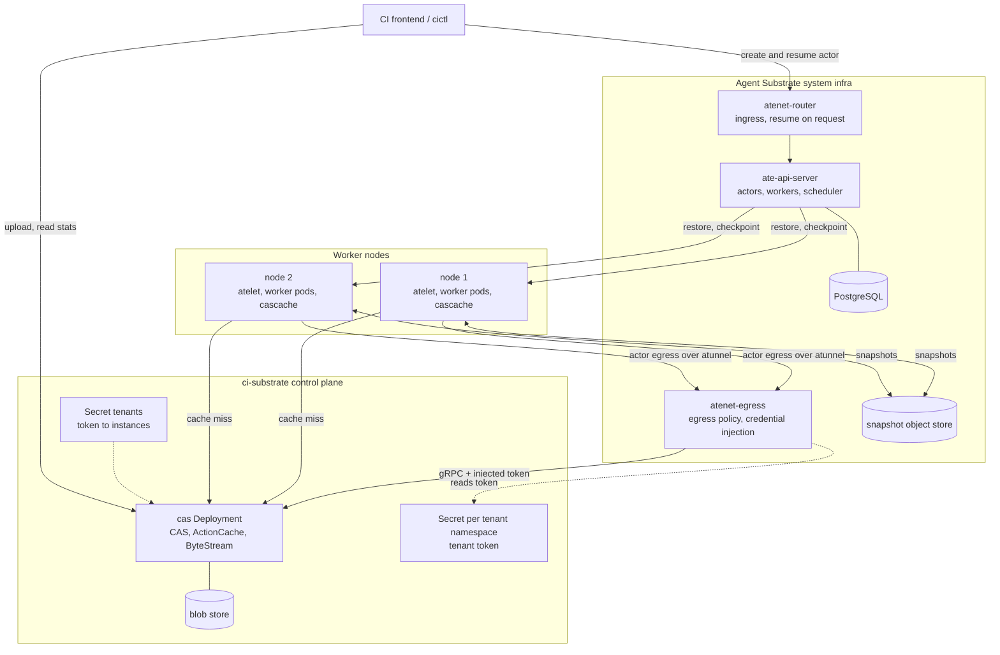
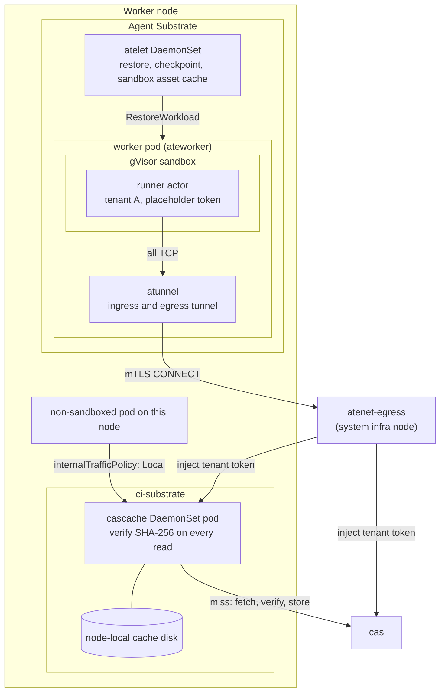

# ci-substrate

A KinD demo of a multi-tenant CI / Bazel Remote Execution control plane in
front of [Agent Substrate](https://github.com/agent-substrate/substrate). The
two properties the demo proves are **multi-tenant isolation** (one tenant
cannot read another's instance) and **optimized caching** (a content-addressed
blob warmed by one tenant is served to another from a node-local verified
cache, with no second origin fetch).

Images are built and applied with [ko](https://ko.build/). There are no
Dockerfiles and no Helm charts.

## What runs

| Binary | Role |
|--------|------|
| `cas` | Authoritative multi-tenant CAS + action cache. Speaks the Bazel Remote Execution API (`ContentAddressableStorage`, `ActionCache`, `ByteStream`, `Capabilities`) over gRPC. |
| `cascache` | Node-local, read-only CAS proxy (DaemonSet, port 9092). Verified read-through cache in front of `cas`. Its Service sets `internalTrafficPolicy: Local`, so a pod reaches the cascache on its own node. |
| `runner` | In-actor build runner. Prefetches inputs from `cascache`, checks the action cache, executes on a miss, uploads outputs, and replays cached output on a hit. |
| `cictl` | Demo driver. Uploads a shared blob as tenant A, warms the cache, reads it as tenant B, and asserts tenant B cannot reach tenant A's instance or action cache. |

Tenant identity is a token on the `x-ci-substrate-tenant` gRPC metadata header.
Each token is allowed a set of Remote Execution instance names. Blobs are
content addressed and shared; action results are namespaced by instance.

## Architecture

The cluster runs two control planes side by side. Agent Substrate owns actor
lifecycle, sandboxing, and network policy. ci-substrate owns build data: the
authoritative `cas` and the per-node `cascache`. The following diagram shows
the cluster, with Substrate's components and ci-substrate's in separate
groups:



Each worker node runs Substrate's per-node pieces next to one cascache pod.
Substrate's `atelet` keeps its own content-addressed cache of sandbox
binaries. cascache does the same job for build inputs and outputs. The
following diagram shows one node:



A read from the runner goes from the sandbox through `atunnel` to
`atenet-egress`, which checks the actor's egress policy, replaces the
placeholder `x-ci-substrate-tenant` header with the tenant's token, and opens
the connection to `cascache`. `cascache` authorizes the token for the
instance, serves the blob from local disk after it verifies the SHA-256, and
on a miss fetches the blob from `cas`, verifies it, and stores it.

## Design notes

Blobs are shared, and action results are private. A blob is named by its
digest, and a tenant that knows a digest can read the blob through any
instance that tenant holds. That is what lets one cached copy serve every
tenant. An instance keeps its action cache private: the map from an action to
its output digests. A tenant can't learn the digests of another tenant's
outputs, so it can't name them. `TestDigestIsReadCapability` in
`internal/remote` pins this down.

The node-local path through Substrate egress isn't node-local yet. Actor
egress leaves the sandbox through `atenet-egress`, which runs on system infra
nodes, so the gateway, not the actor, opens the connection to `cascache`.
`internalTrafficPolicy: Local` then picks the cascache on the gateway's node.
In the kind e2e, `cictl` runs outside Substrate and talks to `cascache`
directly, so the demo doesn't hit this. Two ways to close the gap:

- Hydrate inputs on the host side, the way `atelet` links sandbox binaries
  from its asset cache into each sandbox. A node agent reads from the local
  cascache and exposes inputs to the sandbox as a filesystem. This is the FUSE
  lazy hydration in M5.
- Run an egress gateway on each worker node, so the gateway that dials
  `cascache` shares a node with the actor.

The demo's other limits:

- `cas` keeps the action cache in memory and blobs on an `emptyDir`, so a pod
  restart loses both.
- `cascache` doesn't evict. The kubelet evicts the pod, and with it the warm
  set, when the cache passes the `emptyDir` size limit.
- `cascache` is read-only and serves only the CAS and ByteStream services, so
  Bazel can't use it as `--remote_cache` on its own. Writes and the action
  cache go to `cas`.
- gRPC is plaintext. The egress gateway injects the token on a plain HTTP
  hop, so a real install needs mTLS or a mesh between the gateway and the
  Services.

## Milestone map

| Milestone | In this demo |
|-----------|--------------|
| M1 Control plane state | Job and tenant state live in the CAS/action-cache process, not Kubernetes CRDs. No Postgres or Redis yet; an in-memory action cache is enough for the demo. |
| M2 Substrate lifecycle | An actor template, an egress policy, and a per-tenant token Secret live under `deploy/substrate/`. The default kind e2e does not install Substrate; see that directory's README for the overlay. |
| M3 Artifact push | `runner` uploads stdout and stderr and writes the action cache after exit. The action digest covers the command and an input root that names every prefetched input. |
| M4 Bazel RBE API | `cas` implements the CAS, ActionCache, ByteStream, and Capabilities services from `bazelbuild/remote-apis`. Execution (`Execute`/`WaitExecution`) is not wired yet; the runner drives the same data plane locally. |
| M5 Node-local CAS + verification | `cascache` is the node-local proxy. Every served blob is SHA-256-verified in flight; a poison is dropped and the request falls back to the origin. The production FUSE lazy-hydration guest daemon is modeled by this verified read-through path. |
| M6 Output handling | `remote.Client.Upload` routes blobs up to `remote.MaxBatchBytes` (4 MiB less 64 KiB, so a batch fits gRPC's default message limit) through `BatchUpdateBlobs` and larger ones through `ByteStream.Write`. `FindMissingBlobs` skips content the CAS already holds. |

## Local unit tests

```bash
cd ci-substrate
go test ./...
go test -race ./...
```

The `internal/remote` package includes an in-process gRPC integration test that
covers cross-tenant cache reuse, isolation, poison rejection, large-blob
ByteStream, the batch size boundary, ByteStream write bounds, malformed and
path-traversal digests, and action-cache isolation without needing a cluster.

## KinD end-to-end

Requires Docker. The script installs `kind`, `ko`, and `kubectl` when they are
missing, creates a cluster with a local registry, and deploys with `ko apply`:

```bash
cd ci-substrate
CI_SUBSTRATE_KIND_E2E=1 go test -race -v -timeout 20m ./e2e/
```

Or run the script directly:

```bash
bash e2e/run-kind.sh
```

Set `CI_SUBSTRATE_KIND_KEEP=1` to leave the cluster up afterwards.

The script drives `cictl` from the host over `kubectl port-forward`, so the
demo does not depend on ClusterIP routing (some nested kind environments
cannot program kube-proxy iptables rules). What it asserts:

1. Tenant A uploads a shared blob to `cas`.
2. Tenant A reads it through `cascache`. The cascache `/stats` counters show
   exactly one origin fetch for this read.
3. Tenant B reads the same content through `cascache`. The counters show one
   local hit and no origin fetch.
4. Tenant B is `PermissionDenied` on tenant A's private instance.
5. Tenant A writes an action result, and tenant B is `PermissionDenied`
   reading it.

`deploy/30-cictl-job.yaml` is the same demo as an in-cluster Job for clusters
where Service DNS works.

## Deploy with ko

```bash
export KO_DOCKER_REPO=<your-registry>/ci-substrate
kubectl apply -f deploy/00-namespace-and-config.yaml
ko apply -f deploy/10-cas.yaml
ko apply -f deploy/20-cascache.yaml
ko apply -f deploy/30-cictl-job.yaml
```

On an egress-restricted host that cannot reach `cgr.dev`, point ko at the
docker.io mirror of the same static base:

```bash
export KO_DEFAULTBASEIMAGE=registry-1.docker.io/chainguard/static:latest
```

## Substrate overlay

When Agent Substrate is installed in the cluster, apply the files under
`deploy/substrate/` to run the `runner` inside a gVisor actor whose egress
policy reaches only the cascache and cas Services, with the tenant token
injected by the egress gateway. The default
kind e2e does not install Substrate. Building Substrate's envoy dataplane from
source needs open Debian apt egress; use Substrate's published images or a
machine with unrestricted egress for that install.
