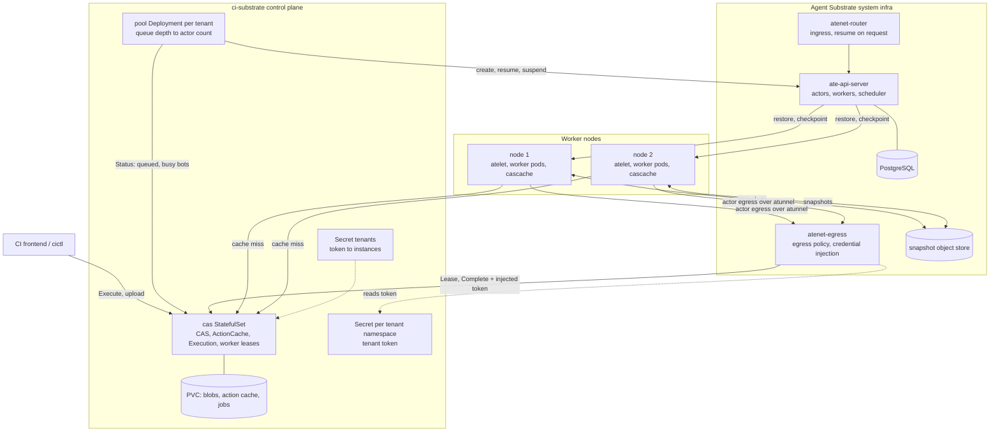
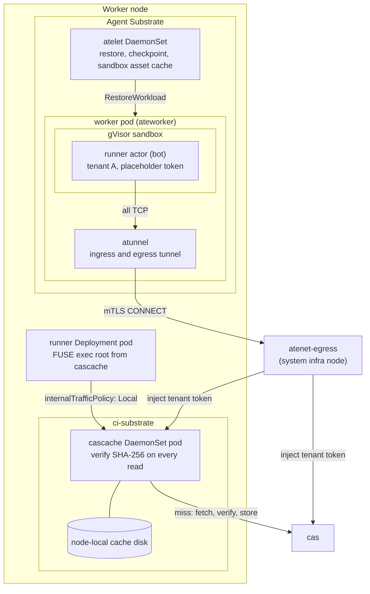

# ci-substrate

A KinD demo of a multi-tenant CI / Bazel Remote Execution control plane in
front of [Agent Substrate](https://github.com/agent-substrate/substrate). The
demo proves **multi-tenant isolation** (one tenant cannot read another's
instance, action cache, or execution queue), **optimized caching** (a
content-addressed blob warmed by one tenant is served to another from a
node-local verified cache, with no second origin fetch), and **remote
execution** (a Bazel `Execute` call runs on a runner that mounts its inputs
lazily from the node-local cache, uploads its outputs, and fills the action
cache for the next call). With Substrate installed, the runners are gVisor
actors that a per-tenant pool keeps warm as snapshots and resumes for queued
work.

Images are built and applied with [ko](https://ko.build/). There are no
Dockerfiles and no Helm charts.

## What runs

| Binary | Role |
|--------|------|
| `cas` | Authoritative multi-tenant CAS, action cache, and scheduler (StatefulSet with a PVC). Speaks the Bazel Remote Execution API (`ContentAddressableStorage`, `ActionCache`, `ByteStream`, `Capabilities`, `Execution`) over gRPC, plus the `WorkerService` that runners lease jobs from. |
| `cascache` | Node-local, read-only CAS proxy (DaemonSet, port 9092). Verified read-through cache in front of `cas`. Its Service sets `internalTrafficPolicy: Local`, so a pod reaches the cascache on its own node. |
| `runner` | The bot. Leases actions from `cas`, builds the exec root from `cascache` (a FUSE mount that hydrates files on first read, or a copy where there is no `/dev/fuse`), runs the command, uploads the outputs `cas` is missing, and reports the `ActionResult`. Runs as a Deployment (`deploy/40-runner.yaml`) or as a Substrate actor. |
| `pool` | Per-tenant actor pool for Substrate. Reads the tenant's queue from `cas` and keeps that many actors running, warm ones suspended, and crashed ones replaced. |
| `cictl` | Demo driver. Uploads a shared blob as tenant A, warms the cache, reads it as tenant B, asserts tenant B cannot reach tenant A's instance, action cache, or queue, then runs an action through `Execute`, checks its outputs, and shows the second `Execute` is a cache hit. |

Tenant identity is a token on the `x-ci-substrate-tenant` gRPC metadata header.
Each token is allowed a set of Remote Execution instance names. Blobs are
content addressed and shared; action results and execution queues are
namespaced by instance, and a runner leases only from the instances its
token holds.

## Architecture

The cluster runs two control planes side by side. Agent Substrate owns actor
lifecycle, sandboxing, and network policy. ci-substrate owns build data and
build work: the authoritative `cas`, the per-node `cascache`, and the pool
that asks Substrate for runners. The following diagram shows the cluster,
with Substrate's components and ci-substrate's in separate groups:



Each worker node runs Substrate's per-node pieces next to one cascache pod.
Substrate's `atelet` keeps its own content-addressed cache of sandbox
binaries. cascache does the same job for build inputs and outputs. The
following diagram shows one node:



A read from the runner goes from the sandbox through `atunnel` to
`atenet-egress`, which checks the actor's egress policy, replaces the
placeholder `x-ci-substrate-tenant` header with the tenant's token, and opens
the connection to `cascache`. `cascache` authorizes the token for the
instance, serves the blob from local disk after it verifies the SHA-256, and
on a miss fetches the blob from `cas`, verifies it, and stores it.

### An Execute call

1. The client uploads the input tree, `Command`, and `Action` to `cas` and
   calls `Execute`. `cas` checks the token for the instance, returns the
   cached `ActionResult` if the action cache has one, and otherwise queues a
   job in that instance's queue. The same action queued twice by the same
   tenant becomes one job with two watchers.
2. A runner holding that tenant's token calls `Lease` and gets the job. It
   heartbeats at a third of the lease duration; a lease that expires goes
   back on the queue.
3. The runner builds the exec root. With `/dev/fuse` it mounts the input
   tree with `casfs` and `cascache` serves each file on its first read; a
   file the command never opens is never fetched. Without it the runner
   copies the tree.
4. The runner runs the command, collects the output paths (files as blobs,
   directories as a `Tree`), asks `cas` which blobs are missing with
   `FindMissingBlobs`, uploads those, and calls `Complete` with the
   `ActionResult`. `cas` writes the action cache and finishes the
   `Operation` every watcher is waiting on.
5. With Substrate, the `pool` for that tenant polls `Status`, and when the
   queue has more jobs than free runners it resumes a suspended actor (a
   memory snapshot restore, about a second) or creates one. A runner that
   has leased nothing for a while is suspended again.

## Design notes

Blobs are shared, and action results are private. A blob is named by its
digest, and a tenant that knows a digest can read the blob through any
instance that tenant holds. That is what lets one cached copy serve every
tenant. An instance keeps its action cache private: the map from an action to
its output digests. A tenant can't learn the digests of another tenant's
outputs, so it can't name them. `TestDigestIsReadCapability` in
`internal/remote` pins this down.

The node-local path through Substrate egress isn't node-local yet. Actor
egress leaves the sandbox through `atenet-egress`, which runs on system infra
nodes, so the gateway, not the actor, opens the connection to `cascache`.
`internalTrafficPolicy: Local` then picks the cascache on the gateway's node.
In the kind e2e, `cictl` runs outside Substrate and talks to `cascache`
directly, so the demo doesn't hit this. Two ways to close the gap:

- Hydrate inputs on the host side, the way `atelet` links sandbox binaries
  from its asset cache into each sandbox. A node agent reads from the local
  cascache and exposes inputs to the sandbox as a filesystem. This is the FUSE
  lazy hydration in M5.
- Run an egress gateway on each worker node, so the gateway that dials
  `cascache` shares a node with the actor.

Of the two, host-side hydration is the one to build. It keeps the actor's
inputs on the actor's node by construction, it removes the per-request
gateway hop from the input path (the gateway still fronts `Lease`,
`Complete`, and output uploads, which are few and small), and it is the
shape Substrate already uses for its own sandbox assets. A gateway per node
fixes locality but keeps every input byte on the tunnel-to-gateway-to-cache
path and adds a component per node whose only job is to be near the actor.
`casfs` is the sandbox half of host-side hydration; what remains is a node
agent that mounts it on the host and projects the mount into the sandbox,
which Substrate's `ActorTemplate` volume API doesn't offer yet (its volume
sources are durable directories, external volumes, images, and system
info). Until then a Substrate runner copies its inputs, and the Deployment
runner shows the FUSE path.

The demo's other limits:

- `cas` is one replica. Its blobs, action cache, and job records are on a
  PVC and survive a restart, but there is no replication.
- `cascache` doesn't evict. The kubelet evicts the pod, and with it the warm
  set, when the cache passes the `emptyDir` size limit.
- `cascache` is read-only and serves only the CAS and ByteStream services, so
  Bazel can't use it as `--remote_cache` on its own. Writes and the action
  cache go to `cas`.
- `casfs` is read-mostly: writes go to an in-memory upper layer that the
  runner reads outputs from, so an action's outputs must fit in memory.
- gRPC is plaintext. The egress gateway injects the token on a plain HTTP
  hop, so a real install needs mTLS or a mesh between the gateway and the
  Services.
- The runner Deployment is privileged, because the container runtime's
  device cgroup otherwise denies `/dev/fuse`. A Substrate actor needs no
  privilege; it copies.

## Milestone map

| Milestone | In this demo |
|-----------|--------------|
| M1 Control plane state | `cas` is a StatefulSet. Blobs, the action cache, and job records are files on its PVC (`internal/blob`, `internal/actioncache`, `internal/exec`), so a restart keeps them. Tenants come from a Secret. No Postgres or Redis; one replica owns the state. |
| M2 Substrate lifecycle | `pool` (`internal/actorpool`, `internal/substrate`) runs per tenant: it prewarms `WARM` actors as snapshots, resumes one per queued job up to `MAX`, suspends idle ones, and replaces crashed ones. The overlay under `deploy/substrate/` has the `WorkerPool`, `ActorTemplate`, egress policy, token Secret, and pool Deployment; `e2e/run-substrate.sh` applies it and runs an action in an actor. |
| M3 Artifact push | The runner uploads stdout, stderr, output files, and output `Tree`s after `FindMissingBlobs`, so a blob `cas` already holds is not sent again. `remote.Client.Upload` routes blobs up to `remote.MaxBatchBytes` through `BatchUpdateBlobs` and larger ones through `ByteStream.Write`. |
| M4 Bazel RBE API | `cas` implements CAS, ActionCache, ByteStream, Capabilities, and Execution (`Execute`, `WaitExecution`) from `bazelbuild/remote-apis`, with a per-instance queue and `WorkerService` leases (`api/worker/v1`) for runners. `Status` tells the pool how deep each queue is. |
| M5 Node-local CAS + verification | `cascache` is the node-local proxy; every served blob is SHA-256-verified in flight, a poison is dropped, and the request falls back to the origin. `casfs` (`internal/casfs`) is the lazy-hydration filesystem: a go-fuse mount of an input `Directory` tree that fetches a file's blob from `cascache` on first read. The runner uses it where `/dev/fuse` exists. |
| M6 Output handling | `internal/bot` collects `OutputPaths`: a file becomes an `OutputFile` with its digest, a directory becomes an `OutputDirectory` with a `Tree` whose root and children are uploaded as blobs. A path that escapes the exec root is rejected. The `ActionResult` carries exit code, stdout, stderr, and the worker's id. |

## Local unit tests

```bash
cd ci-substrate
go test ./...
go test -race ./...
```

The `internal/remote` package includes an in-process gRPC integration test that
covers cross-tenant cache reuse, isolation, poison rejection, large-blob
ByteStream, the batch size boundary, ByteStream write bounds, malformed and
path-traversal digests, and action-cache isolation without needing a cluster.
`internal/exec` tests the scheduler (queueing, leases, expiry, dedupe, and
per-tenant `Status`), `internal/bot` runs a runner against an in-process
`cas` in copy mode and, where `/dev/fuse` exists, FUSE mode, `internal/casfs`
mounts real trees, and `internal/actorpool` drives the pool against a fake
Substrate with a fixed clock.

## KinD end-to-end

Requires Docker. The script installs `kind`, `ko`, and `kubectl` when they are
missing, creates a cluster with a local registry, and deploys with `ko apply`:

```bash
cd ci-substrate
CI_SUBSTRATE_KIND_E2E=1 go test -race -v -timeout 20m ./e2e/
```

Or run the script directly:

```bash
bash e2e/run-kind.sh
```

Set `CI_SUBSTRATE_KIND_KEEP=1` to leave the cluster up afterwards.

The script drives `cictl` from the host over `kubectl port-forward`, so the
demo does not depend on ClusterIP routing (some nested kind environments
cannot program kube-proxy iptables rules). What it asserts:

1. Tenant A uploads a shared blob to `cas`.
2. Tenant A reads it through `cascache`. The cascache `/stats` counters show
   exactly one origin fetch for this read.
3. Tenant B reads the same content through `cascache`. The counters show one
   local hit and no origin fetch.
4. Tenant B is `PermissionDenied` on tenant A's private instance.
5. Tenant A writes an action result, and tenant B is `PermissionDenied`
   reading it.
6. Tenant B is `PermissionDenied` calling `Execute` in tenant A's instance.
7. Tenant A executes an action (`tr a-z A-Z < input.txt > out/upper.txt`,
   plus a copy into `out/tree/`). A `runner` pod leases it, mounts the input
   with FUSE, runs it, and uploads the outputs. `cictl` reads stdout,
   `out/upper.txt`, and the `out/tree` `Tree` back through `cascache`.
8. The same `Execute` again returns `cached_result` without a runner.

`deploy/30-cictl-job.yaml` is the same demo as an in-cluster Job for clusters
where Service DNS works.

## Deploy with ko

```bash
export KO_DOCKER_REPO=<your-registry>/ci-substrate
kubectl apply -f deploy/00-namespace-and-config.yaml
ko apply -f deploy/10-cas.yaml
ko apply -f deploy/20-cascache.yaml
ko apply -f deploy/40-runner.yaml
ko apply -f deploy/30-cictl-job.yaml
```

`.ko.yaml` gives the runner a busybox base, so actions have `sh` and the
usual tools. The other binaries are static.

On an egress-restricted host that cannot reach `cgr.dev`, point ko at the
docker.io mirror of the same static base:

```bash
export KO_DEFAULTBASEIMAGE=registry-1.docker.io/chainguard/static:latest
```

## Substrate overlay

When Agent Substrate is installed in the cluster, apply the files under
`deploy/substrate/` to run the `runner` inside gVisor actors whose egress
policy reaches only the cascache and cas Services, with the tenant token
injected by the egress gateway, and the `pool` that sizes them to the queue:

```bash
export KO_DOCKER_REPO=<a registry pods can pull from>/ci-substrate
bash e2e/run-substrate.sh
```

The script creates the atespace, token Secret, credential grant,
`WorkerPool`, `ActorTemplate`, and pool for `tenant-a`, scales the runner
Deployment to zero so actors do the work, then runs `cictl` and checks that
the worker that ran the action is a `ci-runner-N` actor. On the test cluster
the pool created one actor at start, an `Execute` against the empty queue
ran 44 ms after the actor was up, the pool suspended the actor after two
idle minutes, and the next `Execute` resumed it from its snapshot and ran in
1.4 s end to end.

The default kind e2e does not install Substrate. Building Substrate's envoy
dataplane from source needs open Debian apt egress; use Substrate's published
images or a machine with unrestricted egress for that install. See
`deploy/substrate/README.md` for what the cluster needs.
