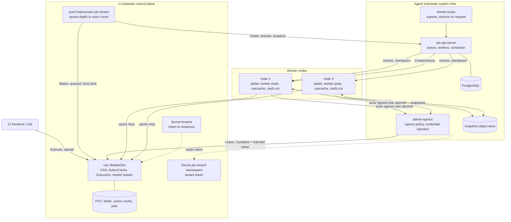
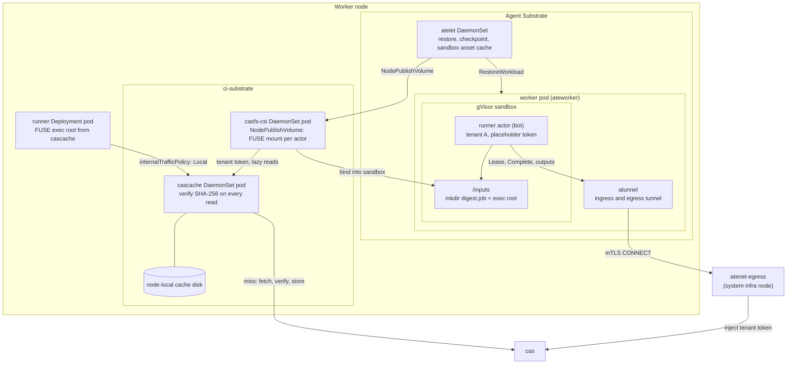

# ci-substrate

A KinD demo of a multi-tenant CI / Bazel Remote Execution control plane in
front of [Agent Substrate](https://github.com/agent-substrate/substrate). The
demo proves **multi-tenant isolation** (one tenant cannot read another's
instance, action cache, or execution queue), **optimized caching** (a
content-addressed blob warmed by one tenant is served to another from a
node-local verified cache, with no second origin fetch), and **remote
execution** (a Bazel `Execute` call runs on a runner that mounts its inputs
lazily from the node-local cache, uploads its outputs, and fills the action
cache for the next call). With Substrate installed, the runners are gVisor
actors that a per-tenant pool keeps warm as snapshots and resumes for queued
work, and each actor reads its inputs from a volume that the CSI driver on
its own node serves out of that node's cache.

Images are built and applied with [ko](https://ko.build/). There are no
Dockerfiles and no Helm charts.

## What runs

| Binary | Role |
|--------|------|
| `cas` | Authoritative multi-tenant CAS, action cache, and scheduler (StatefulSet with a PVC). Speaks the Bazel Remote Execution API (`ContentAddressableStorage`, `ActionCache`, `ByteStream`, `Capabilities`, `Execution`) over gRPC, plus the `WorkerService` that runners lease jobs from. |
| `cascache` | Node-local, read-only CAS proxy (DaemonSet, port 9092). Verified read-through cache in front of `cas`. Its Service sets `internalTrafficPolicy: Local`, so a pod reaches the cascache on its own node. |
| `runner` | The bot. Leases actions from `cas`, builds the exec root (a `mkdir` on the inputs volume a Substrate actor gets from its node, a FUSE mount of `casfs` where the runner has `/dev/fuse`, or a copy from `cascache` otherwise), runs the command, uploads the outputs `cas` is missing, and reports the `ActionResult` with the input mode it used. It starts each command through a copy of its own binary that enters the exec root, because a child that enters a FUSE mount the runner serves before it calls `execve` can deadlock the runner during garbage collection. Runs as a Deployment per tenant (`deploy/40-runner.yaml`) or as a Substrate actor. |
| `casfs-csi` | CSI driver (DaemonSet, `deploy/substrate/casfs-csi.yaml`) that mounts a `casfs` inputs volume for each actor on the actor's node and serves it from that node's `cascache` with the tenant's token. The runner in the sandbox never fetches an input and never holds the token. |
| `pool` | Per-tenant actor pool for Substrate. Reads the tenant's queue from `cas` and keeps that many actors running, warm ones suspended, and crashed ones replaced. |
| `cictl` | Demo driver. Uploads a shared blob as tenant A, warms the cache, reads it as tenant B, asserts tenant B cannot reach tenant A's instance, action cache, or queue, then runs an action through `Execute`, checks its outputs, and shows the second `Execute` is a cache hit. |

Tenant identity is a token on the `x-ci-substrate-tenant` gRPC metadata header.
Each token is allowed a set of Remote Execution instance names. Blobs are
content addressed and shared; action results and execution queues are
namespaced by instance, and a runner leases only from the instances its
token holds.

## Architecture

The cluster runs two control planes side by side. Agent Substrate owns actor
lifecycle, sandboxing, and network policy. ci-substrate owns build data and
build work: the authoritative `cas`, the per-node `cascache`, and the pool
that asks Substrate for runners. The following diagram shows the cluster,
with Substrate's components and ci-substrate's in separate groups:



Each worker node runs Substrate's per-node pieces next to one cascache pod.
Substrate's `atelet` keeps its own content-addressed cache of sandbox
binaries. cascache does the same job for build inputs and outputs. The
following diagram shows one node:



An actor's inputs never leave its node's cache path. When Substrate
restores the actor on a node, `atelet` asks the `casfs-csi` pod on that node
to publish the actor's inputs volume. The driver mounts an empty `casfs`
volume under `/var/lib/ate` and `atelet` binds it into the sandbox at
`/inputs`. For each job, the runner does `mkdir /inputs/<digest>.<job>`,
and the driver loads that input tree's directory protos from the local
`cascache` with the tenant's token, which it looks up from the same tenant
table `cascache` uses. A file's bytes arrive on first read, through the
same cache. `rmdir` drops the exec root. The driver is root on the host,
and the sandbox's user is whoever the image names, so `casfs` reports every
entry as open to everyone and accepts the chown gVisor's gofer does on each
entry it creates; the filesystem itself is the authority on what a name
allows.

The rest of the actor's traffic goes from the sandbox through `atunnel` to
`atenet-egress`, which checks the actor's egress policy, replaces the
placeholder `x-ci-substrate-tenant` header with the tenant's token, and
opens the connection to `cas`: leases, the `Command` and `Action` protos,
output uploads, and the result. The policy names no other destination.
`cascache` authorizes every token for the instance, serves the blob from
local disk after it verifies the SHA-256, and on a miss fetches the blob
from `cas`, verifies it, and stores it.

### An Execute call

1. The client uploads the input tree, `Command`, and `Action` to `cas` and
   calls `Execute`. `cas` checks the token for the instance, returns the
   cached `ActionResult` if the action cache has one, and otherwise queues a
   job in that instance's queue. The same action queued twice by the same
   tenant becomes one job with two watchers.
2. A runner holding that tenant's token calls `Lease` and gets the job. It
   heartbeats at a third of the lease duration; a lease that expires goes
   back on the queue.
3. The runner builds the exec root. A Substrate actor does `mkdir` of the
   input root's digest on its inputs volume, and the `casfs-csi` driver on
   its node serves the tree from that node's `cascache`. A runner with
   `/dev/fuse` mounts the tree itself with `casfs`. In both, `cascache`
   serves each file on its first read, and a file the command never opens is
   never fetched. A runner with neither copies the tree. The `ActionResult`
   records which mode ran the action (`worker.v1.RunnerMetadata` in
   `auxiliary_metadata`), and `cictl -expect-input-mode` checks it.
4. The runner runs the command, collects the output paths (files as blobs,
   directories as a `Tree`), asks `cas` which blobs are missing with
   `FindMissingBlobs`, uploads those, and calls `Complete` with the
   `ActionResult`. `cas` writes the action cache and finishes the
   `Operation` every watcher is waiting on.
5. With Substrate, the `pool` for that tenant polls `Status`, and when the
   queue has more jobs than free runners it resumes a suspended actor (a
   memory snapshot restore, about a second) or creates one. A runner that
   has leased nothing for a while is suspended again.

## Design notes

Blobs are shared, and action results are private. A blob is named by its
digest, and a tenant that knows a digest can read the blob through any
instance that tenant holds. That is what lets one cached copy serve every
tenant. An instance keeps its action cache private: the map from an action to
its output digests. A tenant can't learn the digests of another tenant's
outputs, so it can't name them. `TestDigestIsReadCapability` in
`internal/remote` pins this down.

Inputs are hydrated on the host side, the way `atelet` links sandbox
binaries from its asset cache into each sandbox. Actor egress leaves the
sandbox through `atenet-egress`, which runs on system infra nodes, so a
runner that fetched its own inputs would have the gateway, not the actor,
open the connection to `cascache`, and `internalTrafficPolicy: Local` would
pick the cache on the gateway's node. The alternative, an egress gateway on
each worker node, would fix locality but keep every input byte on the
tunnel-to-gateway-to-cache path and add a component per node whose only job
is to be near the actor. Instead, the `casfs-csi` DaemonSet is a CSI driver
for Substrate's external volumes: the `ActorTemplate` declares an `inputs`
volume of the tenant's `StorageClass`, `ate-api-server` creates it through
the driver's controller Service, and `atelet` has the driver on the actor's
node publish it and binds the mount into the sandbox. The inputs path has no
gateway hop at all, the policy's one rule is `cas` for leases, outputs, and
results, and the sandbox never holds the cache token: the driver resolves the
`StorageClass` parameter `instance` to a token with `tenant.Registry.TokenFor`.
Substrate's `ExternalVolumes` preview gate guards this. The `pool` sends
`Ate-Preview-Allowed: true` on every call, and `run-substrate.sh` turns the
gate on in `ate-api-server`.

A `StorageClass` belongs to one atespace, and the driver enforces it.
Substrate authorizes by atespace and nothing finer: any template, in any
atespace its author can write to, may name any `StorageClass`. A Kubernetes
admission policy can't close that, because `ActorTemplate`s live in
`ateapi`'s database, not in the Kubernetes API. So the class carries an
`atespace` parameter, and on `CreateVolume` the driver checks that the actor
the volume is for (the actor's uid is in the volume name `ateapi` sends) is in
that atespace, by listing that atespace's actors. It acts as its own
`casfs-csi` ServiceAccount, which has the `viewer` role in the atespaces it
serves and nothing else. A volume for any other actor fails with
`PermissionDenied`, and the driver fails closed: a class without the
parameter, a name that isn't an actor's volume, or a lookup that fails
(`Unavailable`) gets no volume, so a tenant never gets another tenant's
inputs. `run-substrate.sh` ends by creating a template in another atespace
that names `casfs-tenant-a` and checking that its actor can't resume.

The volume is a control directory, not a tree: a `mkdir` of
`<hash>-<size>[.<tag>]` materializes that input root, so one long-lived actor
serves many jobs from one mount and two jobs with the same inputs get two
exec roots. A name that isn't a digest fails with `EINVAL`, a digest the
cache doesn't hold fails with `ENOENT`, and the runner's startup probe does
one `mkdir` of the empty tree and one bad name to check it is on such a
volume before it leases anything.

The demo's other limits:

- `cas` is one replica. Its blobs, action cache, and job records are on a
  PVC and survive a restart, but there is no replication.
- `cascache` doesn't evict. The kubelet evicts the pod, and with it the warm
  set, when the cache passes the `emptyDir` size limit.
- `cascache` is read-only and serves only the CAS and ByteStream services, so
  Bazel can't use it as `--remote_cache` on its own. Writes and the action
  cache go to `cas`.
- `casfs` is read-mostly: writes go to an in-memory upper layer that the
  runner reads outputs from, so an action's outputs must fit in memory. On
  the CSI path that memory is the driver pod's, so its limit bounds the
  outputs of every actor on the node at once.
- The `StorageClass` is per tenant and is bound to the tenant's atespace by
  its `atespace` parameter, which needs the `casfs-csi` ServiceAccount to
  have `viewer` in that atespace. The driver checks at `CreateVolume`, once
  per volume. It lists the atespace's actors, one page at a time, so the
  check grows with the number of actors in the atespace.
- The driver keeps its mounts in memory. A driver restart leaves the
  published FUSE mounts stale (reads fail with `ENOTCONN`) until Substrate
  suspends or restarts the actor, and `NodePublishVolume` detaches the stale
  mount before it mounts again.
- gRPC is plaintext. The egress gateway injects the token on a plain HTTP
  hop, so a real install needs mTLS or a mesh between the gateway and the
  Services.
- The runner Deployment is privileged, because the container runtime's
  device cgroup otherwise denies `/dev/fuse`. A Substrate actor needs no
  privilege; the driver on its node does the mounting.

## Milestone map

| Milestone | In this demo |
|-----------|--------------|
| M1 Control plane state | `cas` is a StatefulSet. Blobs, the action cache, and job records are files on its PVC (`internal/blob`, `internal/actioncache`, `internal/exec`), so a restart keeps them. Tenants come from a Secret. No Postgres or Redis; one replica owns the state. |
| M2 Substrate lifecycle | `pool` (`internal/actorpool`, `internal/substrate`) runs per tenant: it prewarms `WARM` actors as snapshots, resumes one per queued job up to `MAX`, suspends idle ones, and replaces crashed ones. The overlay under `deploy/substrate/` has the `WorkerPool`, `ActorTemplate` with its external inputs volume, the `casfs-csi` driver with its `CSIDriverConfig` and the tenant's `StorageClass`, the egress policy, token Secret, and pool Deployment; `e2e/run-substrate.sh` applies it, runs an action in an actor, and checks the actor read its inputs from the volume. |
| M3 Artifact push | The runner uploads stdout, stderr, output files, and output `Tree`s after `FindMissingBlobs`, so a blob `cas` already holds is not sent again. `remote.Client.Upload` routes blobs up to `remote.MaxBatchBytes` through `BatchUpdateBlobs` and larger ones through `ByteStream.Write`. |
| M4 Bazel RBE API | `cas` implements CAS, ActionCache, ByteStream, Capabilities, and Execution (`Execute`, `WaitExecution`) from `bazelbuild/remote-apis`, with a per-instance queue and `WorkerService` leases (`api/worker/v1`) for runners. `Status` tells the pool how deep each queue is. |
| M5 Node-local CAS + verification | `cascache` is the node-local proxy; every served blob is SHA-256-verified in flight, a poison is dropped, and the request falls back to the origin. `casfs` (`internal/casfs`) is the lazy-hydration filesystem: a go-fuse mount of an input `Directory` tree that fetches a file's blob from `cascache` on first read. A runner with `/dev/fuse` mounts it itself; a Substrate actor gets it as an inputs volume that `casfs-csi` (`internal/csidriver`) mounts on the actor's node, so an actor's inputs come from its own node's cache without crossing the egress gateway. |
| M6 Output handling | `internal/bot` collects `OutputPaths`: a file becomes an `OutputFile` with its digest, a directory becomes an `OutputDirectory` with a `Tree` whose root and children are uploaded as blobs. A path that escapes the exec root is rejected. The `ActionResult` carries exit code, stdout, stderr, and the worker's id. |

## Local unit tests

```bash
cd ci-substrate
go test ./...
go test -race ./...
```

The `internal/remote` package includes an in-process gRPC integration test that
covers cross-tenant cache reuse, isolation, poison rejection, large-blob
ByteStream, the batch size boundary, ByteStream write bounds, malformed and
path-traversal digests, and action-cache isolation without needing a cluster.
`internal/exec` tests the scheduler (queueing, leases, expiry, dedupe, and
per-tenant `Status`), `internal/bot` runs a runner against an in-process
`cas` in copy mode and, where `/dev/fuse` exists, FUSE mode, `internal/casfs`
mounts real trees, and `internal/actorpool` drives the pool against a fake
Substrate with a fixed clock.

## KinD end-to-end

Requires Docker. The script installs `kind`, `ko`, and `kubectl` when they are
missing, creates a cluster with a local registry, and deploys with `ko apply`:

```bash
cd ci-substrate
CI_SUBSTRATE_KIND_E2E=1 go test -race -v -timeout 20m ./e2e/
```

Or run the script directly:

```bash
bash e2e/run-kind.sh
```

Set `CI_SUBSTRATE_KIND_KEEP=1` to leave the cluster up afterwards.

The script drives `cictl` from the host over `kubectl port-forward`, so the
demo does not depend on ClusterIP routing (some nested kind environments
cannot program kube-proxy iptables rules). What it asserts:

1. Tenant A uploads a shared blob to `cas`.
2. Tenant A reads it through `cascache`. The cascache `/stats` counters show
   exactly one origin fetch for this read.
3. Tenant B reads the same content through `cascache`. The counters show one
   local hit and no origin fetch.
4. Tenant B is `PermissionDenied` on tenant A's private instance.
5. Tenant A writes an action result, and tenant B is `PermissionDenied`
   reading it.
6. Tenant B is `PermissionDenied` calling `Execute` in tenant A's instance.
7. Tenant A executes an action (`tr a-z A-Z < input.txt > out/upper.txt`,
   plus a copy into `out/tree/`). A `runner` pod leases it, mounts the input
   with FUSE, runs it, and uploads the outputs. `cictl` reads stdout,
   `out/upper.txt`, and the `out/tree` `Tree` back through `cascache`.
8. The same `Execute` again returns `cached_result` without a runner.

Then [`e2e/run-bazel.sh`](e2e/run-bazel.sh) builds
[`e2e/bazel`](e2e/bazel) with stock Bazel (pinned in `.bazelversion` and
downloaded with a checksum) as two users, one in tenant A and one in tenant
B. They have separate workspaces and output roots, but the two workspaces
hold the same salt, so the users send byte-identical actions. Each output
ends with the hostname of the runner that ran it. The script fails unless:

1. Tenant B's build of an action tenant A already built is not an action
   cache hit, and runs on a tenant B runner.
2. When both tenants build the same 24 actions at once, every output comes
   from the builder's own runners. The scheduler never merges the two
   tenants' identical actions into one run.
3. After `bazel clean`, each tenant's rebuild is an action cache hit with
   its own runner's output.
4. A result that tenant A runs locally and uploads to its action cache
   reaches A's remote builds, and tenant B's build of the same action still
   runs on B's runner.
5. Tenant A's token is `PermissionDenied` building in tenant B's instance.

A shared action cache and an instance-blind in-flight merge each pass the
`cictl` checks above. The Bazel checks fail on both. CI runs this script in
the kind e2e, so it blocks a pull request that breaks tenant isolation. It
runs against any cluster with runners for both tenants:
`bash e2e/run-bazel.sh <cas host:port>`.

`deploy/30-cictl-job.yaml` is the same demo as an in-cluster Job for clusters
where Service DNS works.

## Deploy with ko

```bash
export KO_DOCKER_REPO=<your-registry>/ci-substrate
kubectl apply -f deploy/00-namespace-and-config.yaml
ko apply -f deploy/10-cas.yaml
ko apply -f deploy/20-cascache.yaml
ko apply -f deploy/40-runner.yaml
ko apply -f deploy/30-cictl-job.yaml
```

`.ko.yaml` gives the runner the `chainguard/bash` base, so actions have
`bash`, `sh`, and the usual tools: Bazel runs every test through a bash
wrapper. The other binaries are static.

On an egress-restricted host that cannot reach `cgr.dev`, point ko at the
docker.io mirror of the same static base:

```bash
export KO_DEFAULTBASEIMAGE=registry-1.docker.io/chainguard/static:latest
```

## Substrate overlay

When Agent Substrate is installed in the cluster, apply the files under
`deploy/substrate/` to run the `runner` inside gVisor actors that read their
inputs from a `casfs-csi` volume on their own node, whose egress policy
reaches only the `cas` Service, with the tenant token injected by the egress
gateway, and the `pool` that sizes them to the queue:

```bash
export KO_DOCKER_REPO=<a registry pods can pull from>/ci-substrate
bash e2e/run-substrate.sh
```

The script creates the atespace, token Secret, credential grant,
`WorkerPool`, the `casfs-csi` driver and `tenant-a`'s `StorageClass`, the
`ActorTemplate`, and the pool for `tenant-a`, turns on the `ExternalVolumes`
preview gate in `ate-api-server`, scales the runner Deployment to zero so
actors do the work, then runs `cictl` and checks that the worker that ran
the action is a `ci-runner-N` actor and that it reported input mode
`volume`. On the test cluster the pool created one actor at start, an
`Execute` against the empty queue ran 40 ms after the actor was up with its
inputs from the volume, the pool suspended the actor after two idle minutes
(a gVisor checkpoint with the volume bound in), and the next `Execute`
resumed it from its snapshot, had the driver publish a fresh volume, and
ran in 1.3 s end to end.

The default kind e2e does not install Substrate. Building Substrate's envoy
dataplane from source needs open Debian apt egress; use Substrate's published
images or a machine with unrestricted egress for that install. See
`deploy/substrate/README.md` for what the cluster needs.
