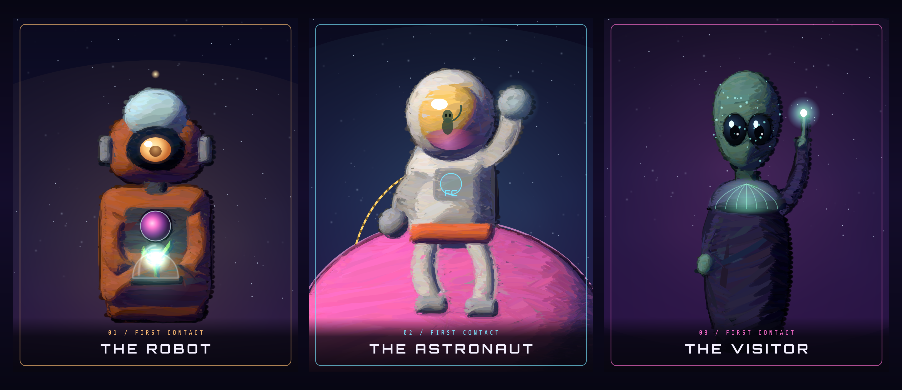

# First Contact

Three sci-fi character cards drawn with [klad](https://github.com/klad-app/klad),
the collaborative painting tool, and composed into one triptych. Each card is a
Python generator that emits `klad apply` ops. The figures are painted as lit
oil forms (one paint layer per part, with a relief effect that lights the paint
body), then unified by a paint-over pass. Soft sketch lines sit under the
brushwork; glow, reflections, and type stay as vectors.

The three archetypes answer each other across the panels:

- `robot.py` is **The Robot**: a rusty caretaker with a glass dome head,
  cradling a glowing sprout under a bell jar. A chest porthole shows the same
  magenta world the astronaut floats over.
- `astronaut.py` is **The Astronaut**: a spacewalker on a tether, one glove
  raised. The gold visor reflects the magenta world and a small waving Visitor.
- `alien.py` is **The Visitor**: a tall being with bioluminescent freckles and a
  glowing collar frill, raising one lit fingertip. Its eyes mirror the
  astronaut's helmet.



## Layout

`kit.py` holds the shared pieces: the key-light direction and warm/cool key and
shadow colours, path helpers, a scumbled dusk sky with soft stars, the numbered
caption frame, and a `Card` class. `Card.paint_form` fills a shape, locks alpha,
runs `klad paint` with oil brushes, and adds a relief effect. Each card then
runs a second apply batch (`--over`) that paint-overs the figure layers.

Each card is a 1024x1280 panel. The triptych stands all three on a 3248x1408
canvas with a 40px gutter and a 48px margin.

## Build

This is not a browser, Go, Rust, or Apple app, so the repository's deploy, test,
and dependency workflows skip it. You build it locally with a klad binary.

klad is source-available and not vendored here. Build it from source (see the
[klad README](https://github.com/klad-app/klad#from-source)), then point the
scripts at the binary with `KLAD=/path/to/klad`, or put `klad` on your `PATH`.
Set `KLAD_FONTS` to klad's `fonts/` folder if the binary can't find its own.

```sh
cd first-contact
KLAD=/path/to/klad ./build.sh robot        # one card -> robot.klad + robot.png
KLAD=/path/to/klad ./triptych.sh           # all three + triptych.klad + triptych.png
```

`build.sh` refuses to overwrite an existing `.klad` bundle, which may hold edits
you made in the editor. Pass `FORCE=1` to rebuild it from the generator.

Open a bundle in the klad editor to watch the strokes and edit any of them:

```sh
klad open first-contact/triptych.klad
```

The committed PNGs are the rendered output of these generators. Rerun the
scripts to reproduce them.
