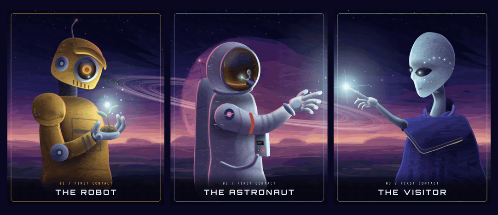

# First Contact

Three sci-fi character cards painted with [klad](https://github.com/klad-app/klad),
the collaborative painting tool, composed into one triptych and animated as a
four-second loop.



The three cards show one moment. The same small mint light is in each of them,
and it is the only lamp that lights the figures:

- `robot.py` is **The Robot**: an old machine that bows its head over a sprout
  it holds up in one hand. The glowing bud lights it from below.
- `astronaut.py` is **The Astronaut**: a spacewalker who reaches a glove
  towards a light just past the edge of the card. The gold visor reflects what
  the astronaut sees: a small figure holding out a lit finger.
- `alien.py` is **The Visitor**: the figure in the visor. The light at its
  fingertip is the one the astronaut reaches for.

One dusk panorama runs behind all three: a ringed planet behind the astronaut,
its rings crossing into the outer cards, and the horizon at the same height.


## How a card is painted

Each card is a Python generator that prints `klad apply` ops as JSON lines.
`kit.py` holds what the cards share.

1. **Shapes.** A silhouette is a smooth curve through hand-placed points
   (`blob`), and a limb, finger, or cable is a tapered tube along a centre line
   (`tube`). A figure is a stack of such forms, back to front.
2. **Light.** A card has one lamp at a point on the canvas. `Card.form` lights
   a form from it: the lamp's colour falls off with distance, a blurred copy of
   the silhouette pushed away from the lamp makes the form shadow, and strips
   along the edges that face the lamp, the planet, and the sky make the edge
   and rim lights. That gives a smooth vector underpainting for each piece of
   the figure. `SKETCH=1 ./build.sh robot` renders only those, in a second or
   two, which is the quick way to work on the drawing.
3. **Paint.** Each piece also has a paint layer. The generator fills the
   piece's silhouette there and locks the layer's alpha, then `klad paintover`
   repaints the underpainting as oil strokes that follow the forms and stay
   inside the silhouette. A relief effect lights the body of the paint. The
   underpainting is hidden afterwards.
4. **Light on top.** Glows, the stars, the rings, drifting motes, and the type
   stay as vectors over the paint, so they keep their edges.

## The rig and the loop

Each figure is cut into rigid pieces: body, head, arm, and hand, plus the
robot's antenna and sprout. `Card.skeleton` gives the pieces bones, parents
first, and the bundle stores them as a klad bones layer with every painted
piece attached to its bone. You can pose the figure with `klad pose`, or with
the bone tool in the editor.

The idle loop is 48 frames at 12 frames a second. `Card.animate` takes a
function from the loop's phase to a turn for each bone, carries the turns down
the chain, and keys the layer of each piece to match. It uses keys because
klad in-betweens a posed bone by drawing every stroke of the piece again for
each frame. That takes minutes for a card with about 60,000 strokes, and a key
only moves the painted layer. Glows that sit on a moving piece follow the same
bone. Opacity keys do the rest: the lights breathe, the beacons blink, the
stars twinkle, and the Visitor blinks once in each loop.

## Layout

Each card is a 1024x1280 panel. The triptych stands all three on a 3248x1408
mat with a 40px gutter and a 48px margin. A card draws the part of the
panorama that falls in its panel, so the backdrop lines up across the gutters.

| File | Contents |
|------|----------|
| `kit.py` | Shapes, the lamp and `Card.form`, pieces and paint-over, the skeleton and `Card.animate`, the backdrop, motes, and the caption frame |
| `robot.py`, `astronaut.py`, `alien.py` | One card each |
| `build.sh` | Builds one card's bundle and renders frame 0 |
| `triptych.sh` | Builds all three, then writes `triptych.png`, `triptych.gif`, and `triptych.mp4` |

## Build

This is not a browser, Go, Rust, or Apple app, so the repository's deploy, test,
and dependency workflows skip it. You build it locally with a klad binary.

klad is source-available and not vendored here. Build it from source (see the
[klad README](https://github.com/klad-app/klad#from-source)), then point the
scripts at the binary with `KLAD=/path/to/klad`, or put `klad` on your `PATH`.
Set `KLAD_FONTS` to klad's `fonts/` folder if the binary can't find its own.
`triptych.sh` also needs `ffmpeg`.

```sh
cd first-contact
KLAD=/path/to/klad ./build.sh robot             # robot.klad and robot.png
KLAD=/path/to/klad SKETCH=1 ./build.sh robot    # the underpaintings only
KLAD=/path/to/klad ./triptych.sh                # all three, the still, and the loop
KLAD=/path/to/klad STILL=1 ./triptych.sh        # all three and the still
```

A card takes about half a minute to build, and the loop about a minute to
render. `build.sh` refuses to overwrite an existing `.klad` bundle, which may
hold edits you made in the editor. Pass `FORCE=1` to rebuild it from the
generator. `triptych.sh` always rebuilds the three bundles.

Open a bundle in the klad editor to play the loop, pose the bones, or edit any
stroke:

```sh
klad open first-contact/robot.klad
```

The committed PNGs and the GIF are the rendered output of these generators.
Rerun the scripts to reproduce them. `triptych.mp4` and the `frames/` folder
are not committed.
