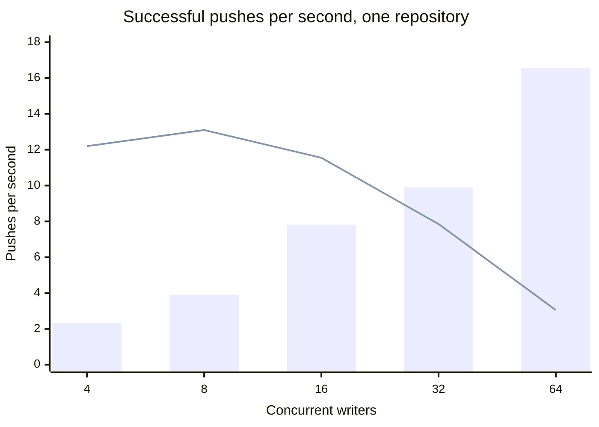
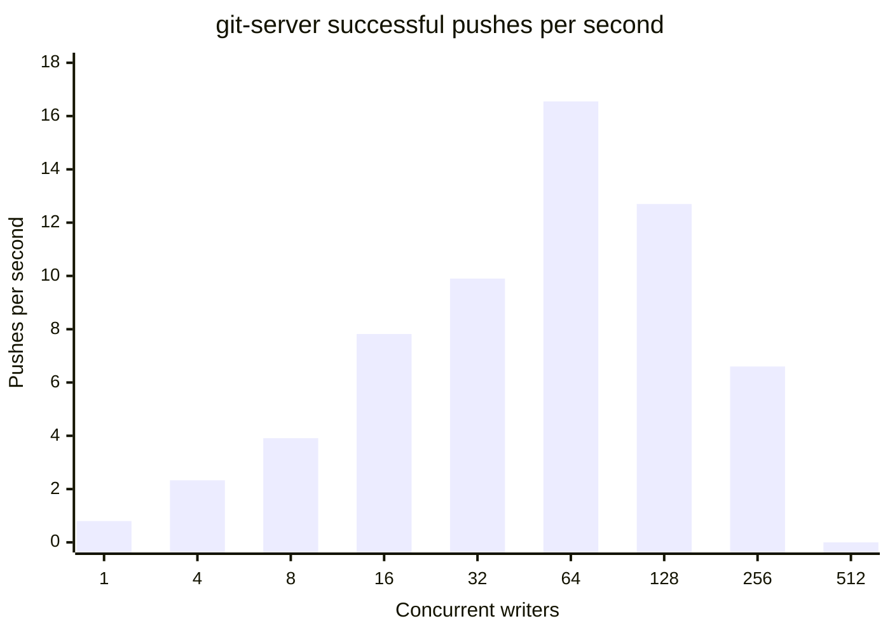
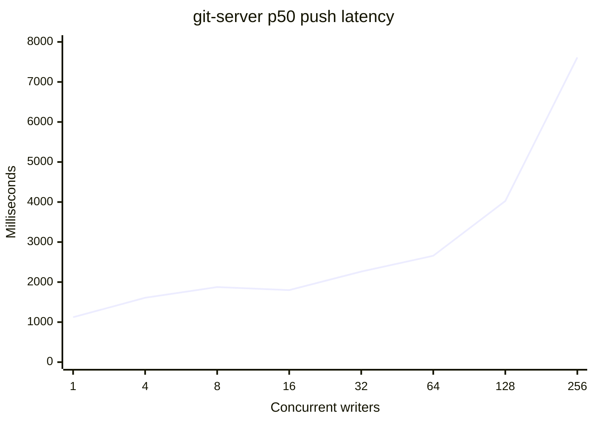
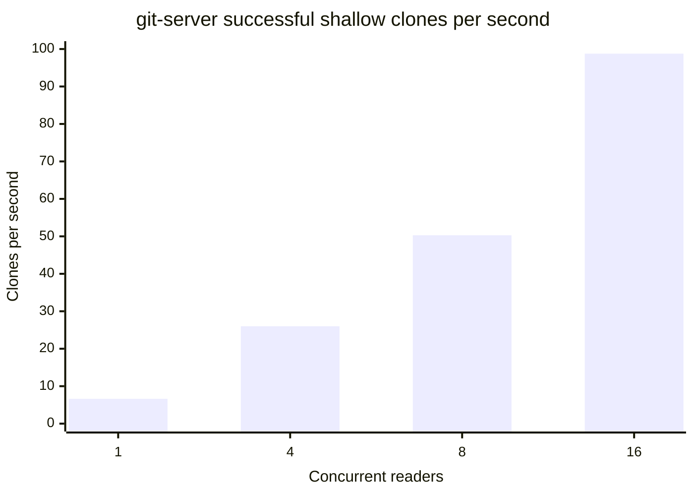

# git-server push and clone benchmarks

This page records [forgemark](https://github.com/entireio/forgemark) runs
against the deployed git-server Worker at `https://git.imjasonh.workers.dev`
and against [Cloudflare Artifacts](https://developers.cloudflare.com/artifacts/).
Every number here comes from runs on October 28, 2026, against the Worker that
`deploy-workers.yml` deployed from commit `77674f4`.

## Summary

On one repository, git-server reaches 16.6 pushes per second at 64
concurrent writers with no failed pushes. Cloudflare Artifacts reaches 6.6
pushes per second with no failed pushes, at 2 writers. Past that, Artifacts
rejects a growing share of pushes, and its successful rate peaks at 13.2
pushes per second at 6 writers, with 43% of attempts rejected.

| Service | Error-free pushes/s | Writers | p50 latency | Errors |
|---|---|---|---|---|
| git-server | 16.6 | 64 | 2.7 s | 0% |
| Cloudflare Artifacts | 6.6 | 2 | 257 ms | 0% |

The two services fail in different ways once a repository is saturated:

- Artifacts keeps latency low and rejects extra pushes. The rejections are
  `artifacts_git_receive_pack_busy`, and at 32 writers or more, HTTP `429`
  with `Rate limit exceeded`.
- git-server accepts every push, and latency grows instead. At 128 and 256
  writers, it still had no failed pushes, but its rate dropped. At 512
  writers, no push finished inside the 20-second window.

## How to read the results

The two services handle a saturated repository in opposite ways.

git-server queues. Every push ends with a read-merge-write on the repository's
Durable Object, which handles one request at a time. Pack building, object
checks, and R2 uploads run in parallel across writers, but each push must
pass through that one step to finish. When writers outnumber what the object
can process, the extra writers wait. Throughput stays near its ceiling, and
each push takes longer.

Artifacts sheds load. When a repository is busy, Artifacts rejects pushes
immediately with `artifacts_git_receive_pack_busy`, and at higher concurrency
with HTTP 429. The pushes it accepts finish in 250 to 330 ms through 16
writers. The cost moves to the writer, which must retry each rejected push.

The results fit the queue model:

- The peak of 16.6 pushes per second implies about 60 ms of serial work per
  push (1 ÷ 16.6). That fits one Durable Object round trip, but we haven't
  measured the apply step on its own.
- At 64 writers, about 50 pushes are in flight at once. That's 16.6 pushes
  per second times a 2.7-second p50, by Little's law.

| | git-server | Artifacts |
|---|---|---|
| Past saturation | Accepts every push, and latency grows | Rejects extra pushes, and accepted latency stays flat |
| Error-free ceiling | 16.6 pushes/s at 64 writers | 6.6 pushes/s at 2 writers |
| p50 of accepted pushes at the peak | 2.7 s at 64 writers | 268 ms at 6 writers |
| What clients must do | Nothing special | Retry rejected pushes with backoff |

Which trade-off suits you depends on whether your clients retry. Pick
git-server if your clients can't retry. Pick Artifacts if your clients retry
with backoff and you need low latency for the pushes that succeed.

The 20-second window undercounts at 128 and 256 writers. A push that
starts near the end of the window may not finish before the clock stops.
Some of the drop in throughput at those counts may come from the window, not
from the server. Runs of two to five minutes at those counts would show
whether the ceiling holds at about 16 pushes per second.

## Method

All runs used forgemark commit `654e95a` from one Mac. Cloudflare served both
services to that Mac from its `EWR` location. forgemark used about 4% of the
Mac's CPU at the highest writer counts, so the client didn't limit the
results.

Each run used a fresh repository, seeded with one commit of 24 files of
about 2.4 KB each. The push runs used forgemark's `branch` strategy: each
writer commits 1-10 files of 2 KB and force-pushes its own ref under
`refs/forgemark/`, in a loop. Writers never push to the same ref, so neither
service reported compare-and-swap conflicts.

| Run | Writers | Warmup | Measured window |
|---|---|---|---|
| git-server pushes and clones | 1, 4, 8, 16 | 8 s | 45 s |
| git-server pushes | 32, 64, 128, 256, 512 | 5 s | 20 s |
| Artifacts pushes | 2, 4, 6, 8, 12, 16, 32, 64 | 5 s | 20 s |

## Pushes to one repository

The following chart compares successful pushes per second at the writer
counts that both services ran. Bars are git-server. The line is Artifacts.



At low writer counts, Artifacts completes more pushes, because each push
takes about 250 ms where a git-server push takes 1.6-1.9 s. Artifacts stops
gaining after 6 writers. git-server keeps gaining until 64 writers, and every
push in its runs succeeded.

| Writers | git-server pushes/s | git-server errors | git-server p50 | Artifacts pushes/s | Artifacts errors | Artifacts p50 |
|---|---|---|---|---|---|---|
| 4 | 2.33 | 0% | 1.6 s | 12.2 | 16% | 242 ms |
| 8 | 3.91 | 0% | 1.9 s | 13.1 | 57% | 285 ms |
| 16 | 7.82 | 0% | 1.8 s | 11.6 | 82% | 332 ms |
| 32 | 9.9 | 0% | 2.3 s | 7.9 | 93% | 476 ms |
| 64 | 16.6 | 0% | 2.7 s | 3.1 | 99% | 1.4 s |

The pushes-per-second columns count successful pushes only. The errors
columns are failed attempts as a percentage of all attempts.

### git-server



| Writers | Pushes/s | Successful pushes | p50 | p95 | p99 | Errors |
|---|---|---|---|---|---|---|
| 1 | 0.80 | 36 | 1.1 s | 1.9 s | 1.9 s | 0% |
| 4 | 2.33 | 105 | 1.6 s | 2.3 s | 2.7 s | 0% |
| 8 | 3.91 | 176 | 1.9 s | 2.7 s | 3.3 s | 0% |
| 16 | 7.82 | 352 | 1.8 s | 3.1 s | 3.9 s | 0% |
| 32 | 9.9 | 198 | 2.3 s | 5.3 s | 7.3 s | 0% |
| 64 | 16.6 | 331 | 2.7 s | 5.0 s | 7.2 s | 0% |
| 128 | 12.7 | 254 | 4.0 s | 19.4 s | 21.1 s | 0% |
| 256 | 6.6 | 132 | 7.6 s | 37.7 s | 39.7 s | 0% |
| 512 | 0 | 0 | none | none | none | none completed |

The 1-16 writer rows used a 45-second window, and the other rows used a
20-second window, so the successful-push counts aren't comparable across
that boundary. The rates are.



At 64 writers, about 50 pushes are in flight at once: 16.6 pushes per second
times a 2.7-second median. Adding writers past that point lengthens the queue
without adding throughput, so latency rises and the completed rate falls.

Each repository has one Durable Object, and every push ends with a
read-merge-write of that object's state. Pack uploads to R2 run in parallel,
but the state update for one repository runs one at a time. At the peak, the
numbers imply about 60 ms of the object's time per push (1 / 16.6). Writers
spread across separate repositories use separate Durable Objects. These runs
didn't measure that case.

### Cloudflare Artifacts

In the following chart, each writer count has two bars: all push attempts
per second, and successful pushes per second. The gap between them is
rejected attempts.

```mermaid
xychart-beta
    title "Artifacts push attempts per second"
    x-axis "Concurrent writers" [2, 4, 6, 8, 12, 16, 32, 64]
    y-axis "Attempts per second" 0 --> 210
    bar [6.6, 14.6, 22.95, 30.35, 48.75, 63.75, 104.25, 207.75]
    bar [6.6, 12.2, 13.2, 13.1, 12.25, 11.55, 7.85, 3.05]
```



| Writers | Successful pushes/s | Attempts/s | Errors | p50 | p95 | Rejections |
|---|---|---|---|---|---|---|
| 2 | 6.6 | 6.6 | 0% | 257 ms | 596 ms | none |
| 4 | 12.2 | 14.6 | 16% | 242 ms | 483 ms | 48 busy |
| 6 | 13.2 | 23.0 | 43% | 268 ms | 565 ms | 195 busy |
| 8 | 13.1 | 30.4 | 57% | 285 ms | 455 ms | 345 busy |
| 12 | 12.25 | 48.8 | 75% | 311 ms | 508 ms | 730 busy |
| 16 | 11.55 | 63.8 | 82% | 332 ms | 580 ms | 1,044 busy |
| 32 | 7.85 | 104.2 | 93% | 476 ms | 988 ms | 1,562 busy, 366 HTTP `429` |
| 64 | 3.05 | 207.8 | 99% | 1.4 s | 2.5 s | 728 busy, 3,366 HTTP `429` |

"Busy" is the `artifacts_git_receive_pack_busy` status in the push report.
forgemark records a rejected push as a failure, and the writer goes on to
its next commit. Rejections come back fast, so attempts per second keep
growing with writers while successful pushes fall.

These runs didn't measure 3 writers, so the error-free ceiling for Artifacts
is between 2 and 4 writers, somewhere from 6.6 to 12.2 pushes per second.

## Shallow clones from git-server

forgemark's `clone` strategy runs depth-1 clones of `main` in a loop. Against
git-server, every clone succeeded.



| Readers | Clones/s | Successful clones | p50 | p95 | p99 | Errors |
|---|---|---|---|---|---|---|
| 1 | 6.6 | 299 | 135 ms | 260 ms | 372 ms | 0% |
| 4 | 26.0 | 1,170 | 128 ms | 312 ms | 429 ms | 0% |
| 8 | 50.3 | 2,263 | 130 ms | 327 ms | 435 ms | 0% |
| 16 | 98.8 | 4,444 | 139 ms | 297 ms | 417 ms | 0% |

Clone throughput scaled with readers, and median latency stayed near 130 ms.
These runs didn't go past 16 readers.

There's no Artifacts clone comparison. forgemark's go-git client got HTTP
`500` from Artifacts on every clone attempt, shallow and full, while stock
`git clone --depth 1` of the same Artifacts repository succeeded.

## Advertised ceilings from other forges

Entire's [launch post](https://entire.com/blog/a-git-forge-without-a-center)
publishes these forgemark push rates for one repository:

| Forge | Advertised pushes/s | Source |
|---|---|---|
| Entire | 418 | Entire's own run |
| Cursor Origin | 65 | Entire's run against Origin |

Entire doesn't publish the writer count, the measurement window, or the
error rate behind either number. forgemark's default writer sweep is 1, 8,
32, and 128. [Upstream](https://upstream.codes/rapid) reprints the same 418
and 65 next to its own forgemark run at 128 agents from AWS `us-west-2`, but
it attributes those two numbers to Entire. At 128 writers, 418 pushes per
second implies a mean push latency of about 300 ms, which fits a client in
the same region as the server.

Cursor's own post about Continuity, the storage layer under Origin, reports
up to 120 pushes per second on S3 Standard and more than 300 on S3 Express
One Zone. That post doesn't use forgemark.

These numbers aren't directly comparable with the runs on this page. They
come from other clients, regions, and writer counts, and don't say whether
any pushes failed.

## Cost of these runs

git-server reports each request's R2 and Durable Object operations in its
`Server-Timing` header. A small push costs 5 R2 Class A operations, 2 Class B
operations, and 2 Durable Object requests, or about $0.0000235 in request
charges at the prices in [`docs/design.md`](docs/design.md).

| Run | Operations | Approximate cost |
|---|---|---|
| git-server, 1-16 writers, pushes and clones | about 790 pushes and 9,600 clones | about $0.06, including Worker CPU |
| git-server, 32-512 writers | about 1,150 pushes, including warmup | about $0.05, including Worker CPU |
| Artifacts, 2-64 writers | about 12,500 push attempts, including warmup | about $1.20-$1.90 |

Artifacts bills $0.15 per 1,000 operations after the first 10,000 each
month. The range depends on whether Artifacts bills rejected and
rate-limited attempts as operations. Storage for every run is a few KB.

## Reproduce

Install forgemark at the same commit:

```bash
GOBIN=/tmp/gobin go install github.com/entireio/forgemark/cmd/forgemark@654e95a
```

Seed a new repository on git-server with one commit, then sweep writers:

```bash
/tmp/gobin/forgemark -remote https://git.imjasonh.workers.dev \
  -token-file TOKEN_FILE -repos REPO \
  -strategy branch -concurrency 1,4,8,16,32,64,128,256 \
  -duration 20s -warmup 5s -out git-server-push.json
```

For Artifacts, create a repository and a write token with the
[Artifacts REST API](https://developers.cloudflare.com/artifacts/api/rest-api/),
seed it, and point forgemark at the repository's host:

```bash
/tmp/gobin/forgemark -remote https://ACCOUNT_ID.artifacts.cloudflare.net \
  -token-file TOKEN_FILE -user x -repos REPO_PATH \
  -strategy branch -concurrency 2,4,6,8,12,16,32,64 \
  -duration 20s -warmup 5s -out artifacts-push.json
```

Replace the following:

- `TOKEN_FILE`: a file that holds the token. git-server ignores it, but
  forgemark requires one.
- `REPO`: the git-server repository name.
- `ACCOUNT_ID`: the Cloudflare account ID in the Artifacts remote URL.
- `REPO_PATH`: the path after the host in the Artifacts remote URL.

Delete the Artifacts repository when you finish, because Artifacts keeps
repositories until you delete them.
