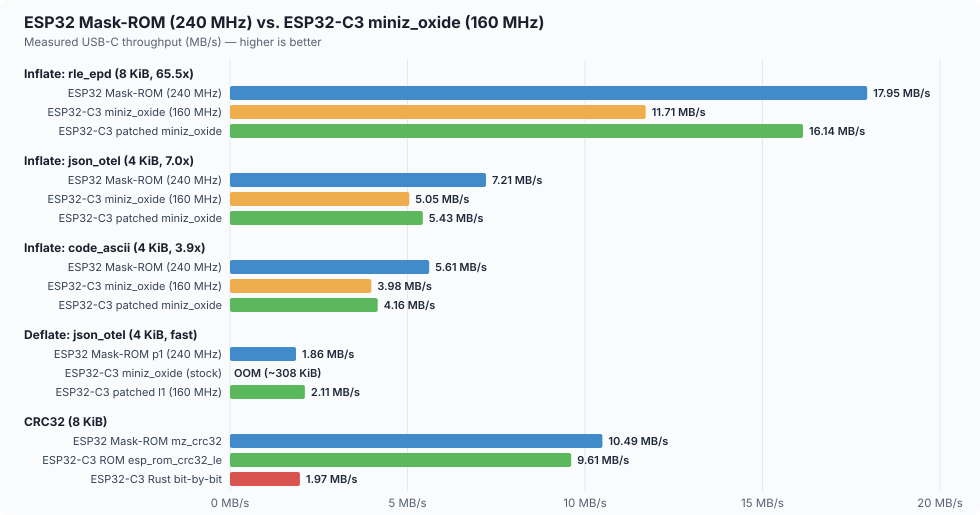
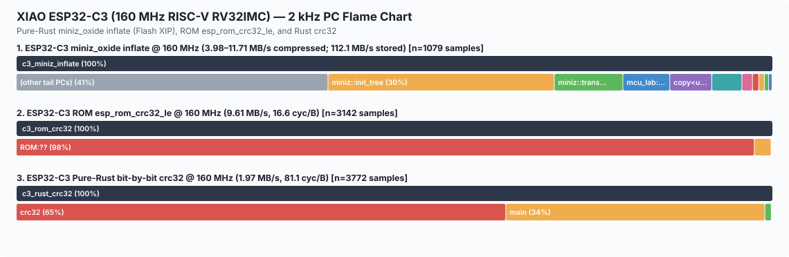

# ESP32 & ESP32-C3 Gzip / DEFLATE Benchmarks

Standalone, direct-USB-C benchmarks and 2 kHz PC profiles comparing:
- **Waveshare ESP32** (`xtensa` LX6 @ 240 MHz, no PSRAM) running **silicon Mask-ROM `miniz`** (`tinfl`, `tdefl`, `mz_crc32`).
- **XIAO ESP32-C3** (`riscv32imc` @ 160 MHz, 400 KiB SRAM) running **pure-Rust `miniz_oxide`** and **ROM `esp_rom_crc32_le`**.



## Reproduce Over USB-C

```bash
cd mcu-lab
make flash-gzip-bench PORT=/dev/cu.usbmodem5ABA0252061       # Waveshare ESP32 (240 MHz, no-BT)
make profile-gzip-bench PORT=/dev/cu.usbmodem5ABA0252061     # Capture + symbolize + SVG flame chart
make flash-gzip-bench-xiao PORT=/dev/cu.usbmodem1101         # XIAO ESP32-C3 (160 MHz, no-BT)
```

---

## 1. Waveshare ESP32 (240 MHz Xtensa, Silicon Mask-ROM)

**Unblocking `tdefl` without PSRAM:** Classic ESP32 splits its 320 KiB DRAM at `0x3ffe0000` (192 KiB lower bank + ~111 KiB upper bank). With Bluetooth enabled, ESP-IDF reserves ~56 KiB at `0x3ffb0000`, capping the largest contiguous block at ~112 KiB — too small for the 167,744-byte Mask-ROM `tdefl_compressor`. Building with `CONFIG_BT_ENABLED=n`, `CONFIG_FREERTOS_UNICORE=y`, and a 4 KiB `main` stack moves `.dram0.heap_start` to `0x3ffb39d8` (**172,032 B contiguous**), fitting `tdefl_compressor` cleanly in internal SRAM.

### Throughput @ 240 MHz

| Operation | Corpus | Time / op | Throughput | Cycles / Byte |
|-----------|--------|----------:|-----------:|--------------:|
| **DRAM `memcpy` ceiling** | `8k_dram` (8 KiB) | 21.5 µs | **380.30 MB/s** | 0.6 |
| **ROM `tinfl` (inflate)** | `incompressible` (stored, 2 KiB) | 10.8 µs | **190.29 MB/s** | 1.3 |
| **ROM `tinfl` (inflate)** | `json_otel_32k` (32 KiB, 40.4×) | 1,145.7 µs | **28.60 MB/s** | 8.4 |
| **ROM `tinfl` (inflate)** | `rle_epd` (8 KiB, 65.5×) | 456.3 µs | **17.95 MB/s** | 13.4 |
| **ROM `tinfl` (inflate)** | `json_otel` / `code_ascii` (4 KiB) | 567.8 / 730.3 µs | **7.21 / 5.61 MB/s** | 33.3 / 42.8 |
| **ROM `tdefl` (`p1_greedy`)** | `rle_epd` / `json_otel` / `json_otel_32k` | 2.28 / 2.20 / 8.89 ms | **3.60 / 1.86 / 3.69 MB/s** | 65–129 |
| **ROM `tdefl` (`p128_default`)** | `rle_epd` / `json_otel` / `json_otel_32k` | 6.50 / 3.45 / 10.33 ms | **1.26 / 1.19 / 3.17 MB/s** | 76–202 |
| **ROM `tdefl` (`p4095_max`)** | `rle_epd` (107.8×) / `json_otel` | 9.07 / 3.45 ms | **0.90 / 1.19 MB/s** | 202–266 |
| **ROM `tdefl` (`p0_huff`)** | `rle_epd` / `json_otel` | 10.71 / 5.60 ms | **0.77 / 0.73 MB/s** | 314–328 |
| **ROM `mz_crc32`** | 8 KiB | 780.9 µs | **10.49 MB/s** | 22.9 |

### Key Bottlenecks (`esp32_rev300_rom.elf` Profile)


1. **`tdefl_compress` byte-by-byte match loop (`0x400603e4–0x400603fa`, 15–30%):** GCC 5.x `-Os` spilled both `src` and `max_len` to the stack inside `tdefl_find_match` (~12–14 cyc/matched byte).
2. **`tinfl_decompress` Huffman LUT rebuild (`0x4005f5d0–0x4005f5de`, ~22%):** Rebuilding 10-bit lookup tables dominates small 4–8 KiB blocks; amortizing over 32 KiB jumps `json_otel` inflate **4×** (`7.21 → 28.60 MB/s`).
3. **`tinfl_decompress` byte-by-byte copy (`0x4005fdb0–0x4005fdc9`, ~15%):** 3×-unrolled `l8ui`/`s8i` loop (~4 cyc/B vs 0.63 cyc/B DRAM `memcpy`).
4. **`mz_crc32` (22.9 cyc/B):** 4-bit nibble LUT is slower than `rle_epd` and `json_otel_32k` inflate.

---

## 2. XIAO ESP32-C3 (160 MHz RISC-V, `miniz_oxide`)

ESP32-C3 tops out at **160 MHz** in hardware, and its single-cycle RV32IMC pipeline runs Flash-XIP `miniz_oxide` at **~1.74× higher IPC** than Xtensa LX6 running `miniz_oxide`. ESP32-C3 *does* also include Mask-ROM `tinfl_decompress` / `tdefl_compress` / `mz_crc32` (`esp32c3_rev3_rom.elf`), which measures **8.05 MB/s** (`8,055,063` B/s, `verified=4/4`) aggregate inflate throughput across the 4 corpora at 160 MHz.

### Throughput @ 160 MHz

| Operation | Corpus | Time / op | Throughput | Cycles / Byte |
|-----------|--------|----------:|-----------:|--------------:|
| **SRAM `memcpy` ceiling** | `8k_sram` (8 KiB) | 36.6 µs | **223.76 MB/s** | 0.7 |
| **`miniz_oxide` inflate** | `incompressible` (stored, 2 KiB) | 18.3 µs | **112.10 MB/s** | 1.4 |
| **`miniz_oxide` inflate** | `rle_epd` (8 KiB, 65.5×) | 699.8 µs | **11.71 MB/s** | 13.7 |
| **`miniz_oxide` inflate** | `json_otel` / `code_ascii` (4 KiB) | 811.0 / 1,029.8 µs | **5.05 / 3.98 MB/s** | 31.7 / 40.2 |
| **ROM `esp_rom_crc32_le`** | 8 KiB | 852.4 µs | **9.61 MB/s** | 16.6 |
| **Rust `protocol::crc32`** | 8 KiB (bit-by-bit) | 4,153.6 µs | **1.97 MB/s** | 81.1 |
| **`miniz_oxide` deflate** | `CompressorOxide` (stock) | — | **OOM** (~308 KiB > 291 KiB free) | — |

### Key Bottlenecks (`mepc` Profile)



1. **`init_tree` (29.9% of inflate):** Rebuilding Huffman lookup tables on every 4–8 KiB block.
2. **`transfer` + `copy<u8>` (14.7% of inflate):** Loops 4 bytes at a time even on long non-overlapping matches.
3. **`CompressorOxide` OOM:** Hardcoded 32 KiB `LZ_DICT_SIZE` + 64 KiB `LZ_CODE_BUF_SIZE` + `LocalBuf` (~308 KiB total) exceeds ESP32-C3's free SRAM.
4. **Bit-by-bit `protocol::crc32` (81.1 cyc/B):** Calling ROM `esp_rom_crc32_le` (`16.6 cyc/B`) is **4.9× faster** at zero RAM cost.

> **Validated local `miniz_oxide` patches:** Compiling `miniz_oxide` at `opt-level = 3`, using a single full-match `copy_within` in `inflate::core::transfer`, and shrinking `LZ_DICT_SIZE` + `LZ_CODE_BUF_SIZE` to `8,192` B (reducing `CompressorOxide` heap from ~308 KiB to **65.3 KiB**) eliminated the deflate OOM and boosted `rle_epd` inflate from **11.71 → 16.14 MB/s** (`9.9 cyc/B`, **+37.8%**), `json_otel` inflate to **5.43 MB/s**, and `miniz_deflate_l1` to **6.78 MB/s** (`rle_epd`) / **2.11 MB/s** (`json_otel`).

---

## 3. Theoretical Maximums (1 Core, Zero Software Bottlenecks)

Assuming IRAM hot loops, 64-bit bitbuffer, 32-bit word-wide LZ77 copy/compare, ≥64 KiB blocks, and Slicing-by-8 CRC32:

| Operation | ESP32 @ 240 MHz | ESP32-C3 @ 160 MHz |
|-----------|------------------:|-------------------:|
| **RAM `memcpy` ceiling** | ~380 MB/s | ~224 MB/s |
| **Inflate — Stored / RLE** | ~240–300 / ~95–160 MB/s | ~160–200 / ~55–90 MB/s |
| **Inflate — JSON / code** | ~32–53 MB/s | ~20–32 MB/s |
| **Deflate — Fast greedy** | ~12–20 MB/s (JSON) / ~24–40 MB/s (RLE) | ~8–13 MB/s (JSON) / ~16–26 MB/s (RLE) |
| **CRC32 (Slicing-by-8)** | ~48–68 MB/s | ~32–45 MB/s |
