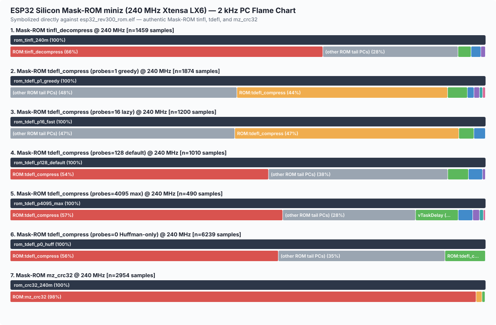

# ESP32 Silicon Mask-ROM `miniz` Benchmark (`gzip-bench`)

`waveshare-epd75-gzip-bench` is a standalone, direct-USB-C benchmark and 2 kHz PC profiler for the **ESP32 silicon Mask-ROM `miniz`** implementation (`tinfl_decompress`, `tdefl_init`, `tdefl_compress`, and `mz_crc32`).

Unlike the BLE OTA apps in `manifest.json`, `gzip-bench` compiles with `CONFIG_BT_ENABLED=n`, `CONFIG_FREERTOS_UNICORE=y`, a 4 KiB `main` stack, and **240 MHz** CPU clock ([`sdkconfig.defaults.epd-nobt.in`](../sdkconfig.defaults.epd-nobt.in)). That moves `.dram0.heap_start` down from `0x3ffc3120` to `0x3ffb39d8`, exposing **172,032 B** of contiguous lower-bank DRAM so the 167,744-byte Mask-ROM `tdefl_compressor` struct fits in internal SRAM without PSRAM.



## Reproduce on USB-C

```bash
cd mcu-lab
make flash-gzip-bench    # builds & flashes 240 MHz no-BT firmware over USB-C
make profile-gzip-bench  # resets board, captures benchmarks + 2 kHz PC profiles, writes SVG
```

## DRAM Allocation Breakdown (Non-PSRAM ESP32)

Classic ESP32 internal DRAM (320 KiB) is physically split at `0x3ffe0000` by ROM static data into a 192 KiB lower bank (`0x3ffb0000–0x3ffe0000`) and a ~111 KiB upper bank (`0x3ffe4350–0x3fffffff`).

| Configuration | `.dram0.heap_start` | Largest Contiguous DRAM | `tdefl_compressor` (`167,744 B`) |
|---------------|--------------------:|------------------------:|:--------------------------------:|
| Default BLE build (`CONFIG_BT_ENABLED=y`, 160 MHz) | `0x3ffc3120` | 114,688 B | OOM (BT reserves 56 KiB at `0x3ffb0000`) |
| Runtime `esp_bt_controller_mem_release(BTDM)` | `0x3ffc3120` | 110,592 B | OOM (freed BT block sits *before* `.dram0.data`) |
| `CONFIG_BT_ENABLED=n`, dual-core, 8 KiB `main` stack | `0x3ffb39d8` | 163,840 B | OOM by 3,904 B |
| **`CONFIG_BT_ENABLED=n`, `UNICORE=y`, 4 KiB `main` stack, 240 MHz** | **`0x3ffb39d8`** | **172,032 B** | **Allocated at `0x3ffb54a8` (127 KiB left in upper bank)** |

`tdefl_init()` on the 167,744-byte struct takes only **13.1 µs** (lazy header initialization).

## Measured Throughput @ 240 MHz (Waveshare ESP32 rev v3.1)

### Memory Ceiling, Mask-ROM `tinfl_decompress`, and `mz_crc32`

| Operation | Corpus (in → out, ratio) | Time / op | Throughput @ 240 MHz | Cycles / Byte |
|-----------|--------------------------|----------:|---------------------:|--------------:|
| **DRAM `memcpy` ceiling** | `8k_dram` (8192 B) | 21.5 µs | **380.32 MB/s** | **0.63** |
| **ROM `tinfl_decompress`** | `rle_epd` (125 → 8192 B, 65.5×) | 456.3 µs | **17.95 MB/s** | 13.4 |
| **ROM `tinfl_decompress`** | `json_otel` (585 → 4096 B, 7.0×) | 567.8 µs | **7.21 MB/s** | 33.3 |
| **ROM `tinfl_decompress`** | `json_otel_32k` (811 → 32768 B, 40.4×) | 1,145.7 µs | **28.60 MB/s** | 8.4 |
| **ROM `tinfl_decompress`** | `code_ascii` (1058 → 4096 B, 3.9×) | 730.3 µs | **5.61 MB/s** | 42.8 |
| **ROM `tinfl_decompress`** | `incompressible` (2053 → 2048 B, stored) | 10.8 µs | **190.29 MB/s** | 1.3 |
| **ROM `mz_crc32`** | All corpora (4-bit nibble LUT) | 780.9 µs / 8 KiB | **10.49 MB/s** | 22.9 |

### Mask-ROM `tdefl_compress` Across Probe Levels (@ 240 MHz)

Every compressed output is round-trip verified through `ROM:tinfl_decompress` + `ROM:mz_crc32`.

| Mode (`flags`) | `rle_epd` (8 KiB) | `json_otel` (4 KiB) | `code_ascii` (4 KiB) | `incompressible` (2 KiB) | `json_otel_32k` (32 KiB) |
|----------------|------------------:|--------------------:|---------------------:|-------------------------:|-------------------------:|
| **`p1_greedy`** (`0x4001`) | **3.60 MB/s** (190 B, 43.1×) | **1.86 MB/s** (676 B, 6.1×) | **1.39 MB/s** (1083 B, 3.8×) | **0.52 MB/s** (2053 B) | **3.69 MB/s** (1414 B, 23.2×) |
| **`p16_fast`** (`16`) | **2.43 MB/s** (195 B, 42.0×) | **1.38 MB/s** (579 B, 7.1×) | **1.00 MB/s** (1061 B, 3.9×) | **0.52 MB/s** (2053 B) | — |
| **`p128_default`** (`128`, zlib ~6) | **1.26 MB/s** (139 B, 58.9×) | **1.19 MB/s** (580 B, 7.1×) | **0.82 MB/s** (1058 B, 3.9×) | **0.52 MB/s** (2053 B) | **3.17 MB/s** (811 B, 40.4×) |
| **`p4095_max`** (`4095`, max) | **0.90 MB/s** (76 B, 107.8×) | **1.19 MB/s** (580 B, 7.1×) | **0.82 MB/s** (1058 B, 3.9×) | **0.52 MB/s** (2053 B) | — |
| **`p0_huff`** (`0`, Huffman-only) | **0.77 MB/s** (1471 B, 5.6×) | **0.73 MB/s** (2353 B, 1.7×) | **0.73 MB/s** (2447 B, 1.7×) | **0.54 MB/s** (2053 B) | — |

## Silicon Mask-ROM Bottlenecks (`esp32_rev300_rom.elf` Disassembly)

1. **`ROM:tdefl_compress+0x328` (`0x400603e4–0x400603fa`, 15–30% of deflate):** GCC 5.x `-Os` spilled both `src` (`l32i.n a6, a1, 40`) and `max_len` (`l32i.n a6, a1, 16`) to the stack inside the byte-by-byte match-compare loop (`l8ui` / `l8ui` / `beq` / `j` / `bne` ≈ 12–14 cycles per matched byte) instead of 32-bit word XOR + `ctz`.
2. **`ROM:tinfl_decompress+0x6a0` (`0x4005f5d0–0x4005f5de`, ~22% of inflate):** 10-bit Huffman LUT fill loop reloads its base pointer from the stack (`l32i a11, a1, 156`) and reloads `0x3ff` every iteration. Combined with `ROM:memset` (2.5%), small 4–8 KiB blocks spend ~25–30% of inflate time rebuilding Huffman tables.
3. **`ROM:tinfl_decompress+0xe80` (`0x4005fdb0–0x4005fdc9`, ~15% of inflate):** 3×-unrolled byte-by-byte `l8ui`/`s8i` match copy (~4 cyc/B vs 0.63 cyc/B DRAM `memcpy`).
4. **`ROM:mz_crc32` (`0x4005ee9c–0x4005eec6`, 22.9 cyc/B):** 4-bit nibble lookup (16 instructions/byte, 10.49 MB/s). On `rle_epd`, CRC32 takes 1.7× longer than inflate itself.

## Measured vs. Theoretical Maximum Throughput (240 MHz Xtensa LX6)

Assuming zero software bottlenecks (240 MHz, IRAM hot loops, 64-bit bitbuffer, 32-bit word-wide LZ77 copy/compare, ≥64 KiB blocks, Slicing-by-8 CRC32):

| Operation | Measured Mask-ROM (1 Core @ 240 MHz) | Theoretical Max (1 Core @ 240 MHz) | Theoretical Max (2 Cores @ 240 MHz) |
|-----------|-------------------------------------:|-----------------------------------:|------------------------------------:|
| **DRAM `memcpy` ceiling** | **380.3 MB/s** | **~380 MB/s** | **~760 MB/s** |
| **Inflate — Stored block** | **186.4 MB/s** | **~240–300 MB/s** | **~480–600 MB/s** |
| **Inflate — RLE (`rle_epd`)** | **17.95 MB/s** | **~95–160 MB/s** | **~190–320 MB/s** |
| **Inflate — Typical JSON / code** | **5.61–7.21 MB/s** | **~32–53 MB/s** | **~64–106 MB/s** |
| **Deflate — Fast greedy (`p1`)** | **1.39–3.69 MB/s** | **~12–20 MB/s** (JSON) / **~24–40 MB/s** (RLE) | **~24–40 MB/s** / **~48–80 MB/s** |
| **Deflate — Default (`p128`, level ~6)** | **0.82–3.17 MB/s** | **~4–8 MB/s** | **~8–16 MB/s** |
| **CRC32** | **10.49 MB/s** | **~48–68 MB/s** (Slicing-by-8) | **~96–136 MB/s** |
