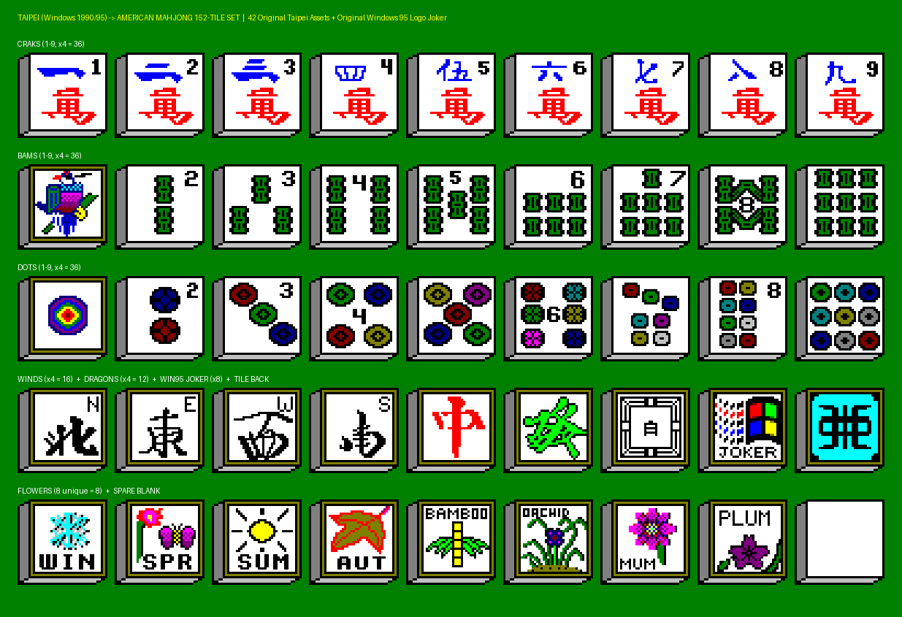
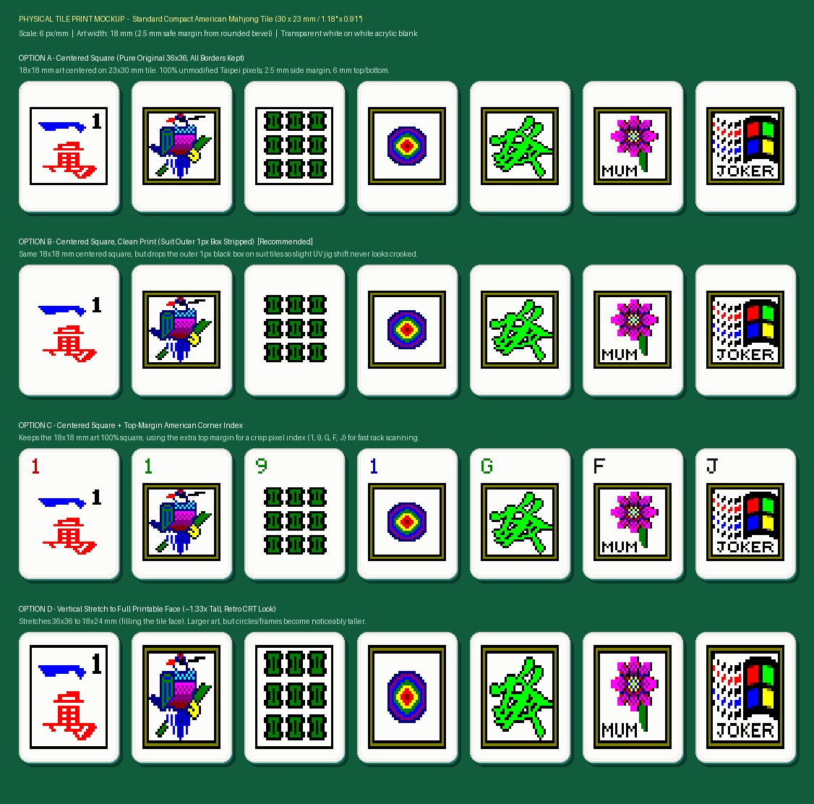

# Taipei (Windows 95) — American Mahjong Tile Set

An American Mahjong (152-tile NMJL / 160-tile retail) tile set built from the original 36×36 16-color VGA tile bitmaps of Dave Norris's Windows *Taipei* (Microsoft Entertainment Pack 1 / *Best of Microsoft Entertainment Pack*, archived via [tDavidM/Taipei](https://github.com/tDavidM/Taipei)), extrapolated with a **Windows 95 flying-flag Joker** (using the original 32×32 `windows-logo-32.png` from [wieslawsoltes/Win95](https://github.com/wieslawsoltes/Win95)) and a spare **Blank** tile.

## Tile Breakdown (152 Playing Tiles + Spares)

| Group | 152-Tile NMJL | 160-Tile Retail | Source |
|---|---:|---:|---|
| **Craks (1–9)** | 36 (4× each) | 36 | Original Taipei `#1.bmp`–`#9.bmp` |
| **Bams (1–9)** | 36 (4× each) | 36 | Original Taipei `#10.bmp`–`#18.bmp` (incl. 1 Bam bird) |
| **Dots (1–9)** | 36 (4× each) | 36 | Original Taipei `#19.bmp`–`#27.bmp` (incl. rainbow 1 Dot) |
| **Winds (N, E, W, S)** | 16 (4× each) | 16 | Original Taipei `#28.bmp`–`#31.bmp` |
| **Dragons (Red 中, Green 發, White/Soap 白)** | 12 (4× each) | 12 | Original Taipei `#32.bmp`–`#34.bmp` |
| **Flowers** | 8 (1× each) | 8 | Original Taipei 4 Seasons (`WIN`, `SPR`, `SUM`, `AUT`) + 4 Flowers (`BAMBOO`, `ORCHID`, `MUM`, `PLUM`) |
| **Jokers (Wild)** | 8 | 10 | Original Windows 95 32×32 flag (`30×23` bbox, exact 16-color VGA) in Taipei's olive/black double frame + `JOKER` |
| **Blank (Spare)** | 0 | 6 | Extrapolated pure-white tile with Taipei's 1px black outer border |
| **Tile Back / Logo** | — | — | Original Taipei `#44.bmp` |

## Directory Layout

- `1x/` — 45 native `36×36` PNGs
- `4x/` — 45 nearest-neighbor `144×144` PNGs
- `3d_4x/` — 45 nearest-neighbor 3D Taipei-beveled PNGs (`164×156`)
- `spritesheet_1x.png`, `spritesheet_4x.png`, `manifest.json` — horizontal tile strips and metadata
- `showcase.png` — full tile set showcase on Taipei felt green (`#008000`)
- `print_layout_mockups.png` — physical `30×23 mm` tile layout comparison (Options A–D)
- `print_option_a/` — print-ready pack for **Option A (Centered Square with Outline)** on standard `30 × 23 mm` American Mahjong tiles:
  - `svg_transparent_30x23mm/` — 45 crisp vector SVGs (`23.0 × 30.0 mm` canvas, `18.0 × 18.0 mm` centered art at `0.50 mm/pixel`, transparent white for white acrylic blanks)
  - `png_600dpi_30x23mm/` — 45 transparent 600 DPI PNGs (`543 × 709 px`, exact `12×` integer scaling)
  - `taipei_option_a_152_tiles_1to1_letter.pdf` — 3-page US Letter PDF at 1:1 physical scale (print at 100% / Actual Size)
  - `PRINT_MANIFEST.csv` & `README.txt` — tile quantities and UV print-shop instructions

